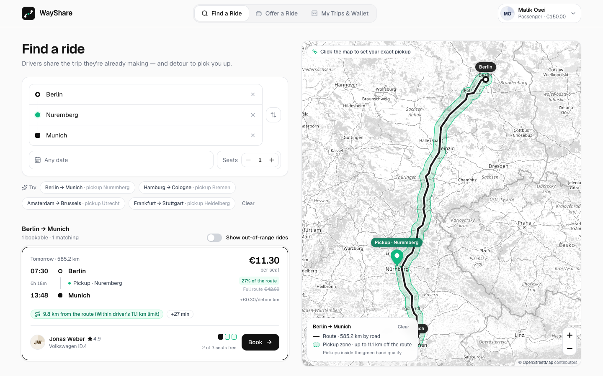

# WayShare

Minimalist peer-to-peer carpooling. Drivers offer the empty seats on a trip they are already
making, choose how many kilometres they are willing to detour for a pickup, and passengers book
and pay per seat. Payments sit in escrow until the driver enters the passenger's 4-digit boarding
PIN at pickup.



**Stack:** Next.js 16 (App Router, Cache Components) · TypeScript · Prisma 7 + SQLite ·
Tailwind CSS 4 · Leaflet / react-leaflet · OSRM + Nominatim (with offline fallbacks) · Zod 4

---

## Quick start

Requires Node.js ≥ 20.9 (developed on Node 26).

```bash
npm install          # also generates the Prisma Client
npm run setup        # creates ./dev.db, generates the client, seeds demo data
npm run dev          # http://localhost:3000
```

Production build: `npm run build && npm start`.

Seeded departures are relative to the moment you seed (tomorrow, in 2 days, …). When they have
departed, run `npm run db:reset` to wipe and re-seed.

## Demo accounts

Switch accounts from the avatar menu in the top-right corner; no password needed.

| Account | Role | Seeded state |
| --- | --- | --- |
| **Lena Fischer** | Passenger | Holds 1 seat on Jonas' *Berlin → Munich* ride, picked up at Berlin Hbf. **Boarding PIN `4827`**, €46.07 in escrow |
| **Malik Osei** | Passenger | €150 wallet, no bookings |
| **Jonas Weber** | Driver · Volkswagen ID.4 | Berlin → Munich, Frankfurt → Stuttgart, Cologne → Berlin |
| **Sofia Martins** | Driver · Tesla Model 3 | Hamburg → Cologne, Amsterdam → Brussels, Munich → Vienna (0 km detour) |

## A five-minute tour

1. **Search with a pickup.** As *Malik*, open **Find a Ride** and tap the suggestion
   *Berlin → Munich · pickup Nuremberg*. The ride shows **9.8 km from the route (Within driver's 11.1 km limit)**
   and costs €11.30 instead of €42.00, because Malik rides only the last 27% of the trip.
   Click the ride to draw its road route. The green band along it is the driver's pickup zone.
   Nothing is drawn until you choose a route or a ride.
2. **Explore the pickup zone.** Drag the green pickup pin, or click anywhere on the map. Drop it in
   Leipzig, 13 km from the A9, and the ride leaves the zone. Turn on **Show out-of-range rides** to
   see *Outside pickup zone (13 km from the route vs 11.1 km left)*.
3. **Book.** Pick Nuremberg again, click **Book**, check the itemised price, then **Confirm & Pay**.
   Your boarding PIN appears right away and again in **My Trips & Wallet**.
4. **Release escrow, or decline.** Switch to *Jonas*, open **My Trips & Wallet**, and enter Lena's
   PIN `4827` in the passenger manifest. The payout lands in Jonas' wallet ledger. Use **Decline
   passenger** on Malik's row instead to refund him and reopen the seat.
5. **Offer a ride.** In **Offer a Ride**, pick two cities and move the pickup-radius slider. The
   green band along your route on the live map widens and narrows with it. Try *Charge per km*,
   then **Publish ride**.
6. **Payments.** At checkout, pay from the wallet or with the simulated card. `4242 4242 4242 4242`
   succeeds, `4000 0000 0000 0002` is declined. **+ €50 Test Top-Up** refills any wallet.

## The detour engine (`src/lib/geo.ts`)

Every ride stores its **road route** when it's published: an OSRM polyline, or the straight line
origin → destination if routing is unreachable. For a passenger waiting at **P**:

```
offRoute = distance from P to the ride's route line        how far off the road the pickup is
ΔD       = 2 × offRoute × 1.22                            extra driving: leave the route and come back
ΔT       = round(ΔD × 1.15)                               extra minutes
```

The driver's **pickup radius** (`maxDetourKm`, the slider on Offer a Ride) is how far off the
route they'll go. A pickup is **eligible** iff `offRoute ≤ ride.remainingDetourKm`,
`seats ≤ ride.availableSeats` and `ride.status = "OPEN"`. Every booking spends its pickup's
`offRoute` from the remaining radius (`Booking.offRouteKm`); a cancellation or decline returns it.

**What you see is what's checked.** The eligible area is exactly a band along the route, the
remaining radius wide on each side. The map draws that band as a round-capped stroke around the
same stored polyline. The stroke's pixel width is recomputed from the ground resolution on every
zoom, so the band and the eligibility check agree.

**Online vs offline.** Search, booking and every map use the ride's stored route, so the quote shown
in search is exactly what the booking API charges, with or without a network. OSRM is called only
when a ride is published and for the Offer preview. The seed ships with pre-fetched routes, so it
needs no network. Nominatim adds street-level search and labels for dropped pins. Both services sit
behind timeouts, TTL caches and a circuit breaker. If either is unreachable, WayShare falls back to
straight lines with a Haversine × 1.22 distance and the built-in directory of 70+ cities, without
stalling.

**Pricing** (`src/lib/pricing.ts`, shared by checkout and API). The driver sets one price per
seat for the **full route**. Everyone is dropped at the destination, so a passenger who boards
along the way pays for the share of the route they actually ride:

```
routeShare = route distance from P's nearest point to B / route length
fareShare  = max(20 %, routeShare rounded to whole %)    a stop is never free for the driver
seatPrice  = fullPrice × fareShare, rounded to €0.10
seatCost   = seats × seatPrice
detourCost = ΔD × detourPricePerKm                       charged once per pickup
platformFee = max(€0.50, 8 % of seatCost + detourCost)   the driver receives seatCost + detourCost
```

On Jonas' €42 Berlin → Munich ride, boarding in Berlin costs €42.00, in Nuremberg (27 % of the
route left) €11.30, and in Ingolstadt (13 %, so the 20 % minimum applies) €8.40.

## Money flow

```
passenger wallet ──ESCROW_HOLD──▶ escrow ──PIN verified──▶ DRIVER_PAYOUT ──▶ driver wallet
                                    │
                                    └──passenger cancels / driver declines / trip cancelled──▶ REFUND ──▶ passenger wallet
```

Every movement is a `Transaction` row, so each wallet balance equals the sum of its ledger.
A card payment is recorded as a `TOP_UP` immediately followed by the `ESCROW_HOLD`.

**Declining a passenger.** In the passenger manifest a driver can decline anyone not yet picked
up. The booking becomes `DECLINED`, the passenger is refunded in full, and the seat and detour
budget go back to the ride (a `FULL` ride reopens). That passenger can't book the same ride again;
search shows it as declined for them.

## Architecture

```
prisma/
  schema.prisma          User · RideOffer · Booking · Transaction (portable to PostgreSQL)
  seed.ts                4 users, 6 rides, 1 booking in escrow — built with the app's own engine
prisma.config.ts         Prisma 7 CLI config (datasource URL, seed command)
src/
  app/                   routes: / (find) · /offer · /trips — plus app/api/** route handlers
  lib/
    geo.ts               city directory, route projection, detour, eligibility, polyline codec (isomorphic)
    pricing.ts           quote + fair-split suggestion (isomorphic)
    contracts.ts         Zod schemas for every request and response (shared by server and client)
    api-client.ts        typed fetch client that validates every response
    hooks.ts             keyed data loading, debouncing, OSRM directions
    server/
      db.ts              Prisma client (better-sqlite3 adapter) + SERIALIZABLE retrying transactions
      session.ts         demo session cookie (the account switcher)
      http.ts            route wrapper, Zod/Prisma error mapping, JSON helpers
      geo-services.ts    OSRM / Nominatim with caching, throttling and fallbacks
      payments.ts        simulated card processor (Luhn, expiry, decline test cards)
      pin-guard.ts       brute-force protection for pickup PINs
      services/          rides · bookings · accounts — all business rules live here
  components/            app shell, UI primitives, map, and the three views
```

Every write that moves money or capacity runs in a SERIALIZABLE interactive transaction with
compare-and-swap guards, so concurrent bookings cannot oversell seats or detour budget, even on
PostgreSQL. The Leaflet map is client-only (`next/dynamic` with `ssr: false`). It uses a custom
container on `@react-leaflet/core` that survives Next.js' `<Activity>`-based route preservation,
where react-leaflet's stock `MapContainer` would be destroyed.

## API

All bodies and query strings are validated with Zod. Errors look like
`{ "error": { "code", "message", "fieldErrors"? } }`. The acting user comes from the
`wayshare_uid` cookie set by the account switcher.

| Method & path | Purpose |
| --- | --- |
| `GET /api/users` | Demo accounts for the switcher plus the active account |
| `POST /api/session` | Switch the active account `{ userId }` |
| `POST /api/users/topup` | Add test credit `{ amount = 50 }` |
| `GET /api/rides` | Search: `originLat/Lng`, `destLat/Lng`, `pickupLat/Lng`, `seats`, `date` (+ `tzOffset`). Each ride is returned with `detourDistanceKm`, `detourDurationMin`, `isWithinDetourRadius` and a `priceBreakdown` with the passenger's distance-based fare (`routeShare`, `fareShare`, `pricePerSeat`) |
| `POST /api/rides` | Publish a ride (base distance/duration from OSRM or estimate) |
| `POST /api/rides/:id/cancel` · `/complete` | Driver cancels (refunds everyone in escrow) or closes a trip |
| `POST /api/bookings` | Atomic booking: eligibility → payment → escrow → capacity → PIN |
| `POST /api/bookings/:id/verify-pin` | Driver releases escrow `{ pin }` (5 attempts, then 10-minute lock) |
| `POST /api/bookings/:id/cancel` | Passenger cancels: full refund; seats and detour budget return to the ride |
| `POST /api/bookings/:id/decline` | Driver declines a passenger: same refund and release; the passenger can't rebook that ride |
| `GET /api/trips` | Dashboard: bookings with PINs, ride manifests (never PINs), wallet and ledger |
| `GET /api/geocode?q=` · `/api/geocode/reverse?lat=&lng=` | Nominatim proxy with directory fallback |
| `GET /api/directions?points=lat,lng;lat,lng` | OSRM proxy with Haversine fallback |

```bash
curl "localhost:3000/api/rides?originLat=52.52&originLng=13.405&destLat=48.1351&destLng=11.582&pickupLat=51.3397&pickupLng=12.3731&seats=1"
```

## Configuration

All variables are optional.

| Variable | Default | |
| --- | --- | --- |
| `DATABASE_URL` | `file:./dev.db` | SQLite file, relative to the project root |
| `OSRM_URL` | `https://router.project-osrm.org` | Point at a self-hosted OSRM for production |
| `NOMINATIM_URL` | `https://nominatim.openstreetmap.org` | Point at a self-hosted Nominatim for production |
| `WAYSHARE_OFFLINE` | unset | `1` skips all network services and uses the deterministic fallbacks |

## Scripts

| Script | |
| --- | --- |
| `npm run dev` / `build` / `start` | Next.js |
| `npm run setup` | `db push` + `generate` + `db seed` |
| `npm run db:reset` | Wipe the database and re-seed |
| `npm run lint` · `npm run typecheck` | ESLint (incl. React Compiler rules) · TypeScript |

## Moving to PostgreSQL

1. Set `provider = "postgresql"` in `prisma/schema.prisma` and point `DATABASE_URL` at your database.
2. `npm i @prisma/adapter-pg`, then swap `PrismaBetterSqlite3` for `PrismaPg` in `src/lib/server/db.ts`
   and `prisma/seed.ts`.
3. Run `npx prisma migrate dev` to create versioned migrations.

## Before real users

This is a complete, working product, but some parts are deliberately demo-grade:

- **Auth:** the account switcher replaces login. Swap `src/lib/server/session.ts` for a real
  auth provider.
- **Money:** amounts are `Float` euros, as specified, rounded to cents on every write. Use
  `Decimal` or integer cents on PostgreSQL.
- **Payments:** card processing is simulated. Integrate a real PSP with authorise/capture.
- **Multiple instances:** the PIN attempt limiter and geo caches are in-memory. Use Redis.
- **Map services:** the public OSRM, Nominatim and OSM tile servers have fair-use policies.
  Self-host them, or use a commercial provider, for production traffic.
